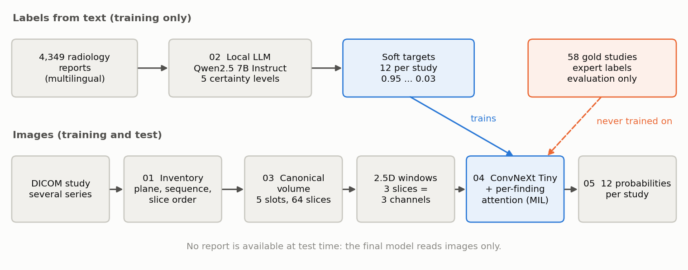

# KneeMIL

[](https://kneemil.readthedocs.io)
[](https://github.com/Hermine-K/kneemil/actions)


[](https://www.kaggle.com/competitions/rsna-knee-abnormality-detection)

**Knee MRI abnormality detection from weak, multilingual radiology report supervision.**

A complete pipeline for the RSNA Knee Abnormality Detection challenge (Kaggle, 2026): predict 12
abnormalities for every knee MRI study. Only 58 of the 4,407 training studies carry expert labels;
the 4,349 others only have a free-text radiology report, in several languages, and no report is
available at test time. **The core problem is supervision, not vision.**



## Highlights

- **Labels from text.** A local open-weights LLM (Qwen2.5 7B) grades each finding in 4,349
  multilingual reports on five certainty levels, turned into soft targets. Measured on the gold
  studies before use: macro AUC 0.758, then 0.839 after three iterations, zero unparsed answers.
- **Canonical volume.** Every study becomes a fixed 64-slice volume of 5 slots chosen from the
  series descriptors, cropped in millimetres, with a validity mask for missing series.
- **Multiple instance learning with one attention head per finding.** 2.5D windows, a shared
  ConvNeXt Tiny and 12 attention heads, so that an ACL tear and osteoarthritis each look at their
  own slices. The attention weights make every prediction inspectable.
- **Honest evaluation.** The 58 expert-labelled studies are never used for training; scores come
  with bootstrap confidence intervals.

## Results

| Model | Gold macro AUC (58 studies) | 95 % CI | Public leaderboard |
|---|---|---|---|
| LLM labels (text) | 0.839 | | |
| Image model | **0.907** | 0.879 to 0.932 | 0.899 |
| Ensemble of 2 seeds | 0.903 | 0.873 to 0.928 | **0.906** |

**The image model overtakes the labels it was trained on** (0.907 against 0.839): errors in the
text are scattered, while visual signs are consistent. The gains are largest where reports are
weakest: fracture 0.80 to 0.96, effusion 0.77 to 0.92, contusion 0.77 to 0.92.

<p align="center"></p>

## Repository layout

```
src/kneemil/          reusable, tested package
  constants.py        12 findings, canonical volume layout
  paths.py            locating data and notebook outputs on Kaggle
  dicom.py            header reading, spatial slice sorting, pixels
  volume.py           series selection, mm crop, canonical volume, 2.5D windows
  labels.py           LLM prompt, tolerant parser, soft targets, memory-safe batching
  metrics.py          macro AUC, bootstrap confidence interval
  model.py            MIL model with per-finding attention (torch, timm)
notebooks/            the Kaggle notebooks that produced the scores, run in order 01 to 05
tests/                35 tests on synthetic DICOM data (no patient data)
docs/                 documentation site (MkDocs Material)
scripts/              figure generation
```

## Quick start

```bash
git clone https://github.com/Hermine-K/kneemil.git
cd kneemil
pip install -e ".[dev]"        # add ".[model]" for torch and timm
pytest -q
```

The full pipeline runs on Kaggle, where the 570 GB dataset is mounted: see
[Running the pipeline](https://kneemil.readthedocs.io/en/latest/running/).

## Documentation

**[kneemil.readthedocs.io](https://kneemil.readthedocs.io)**: problem, architecture, LLM labelling,
training, results, and a candid page on lessons and limitations.

## Data

No competition data, derived labels, images or model weights are included. The data is subject to
the competition rules and is only available on Kaggle.

## License

MIT, see [LICENSE](LICENSE).

## Author

Hermine Kiossou, MSc Bioinformatics (Université de Montpellier).
[GitHub](https://github.com/Hermine-K)
