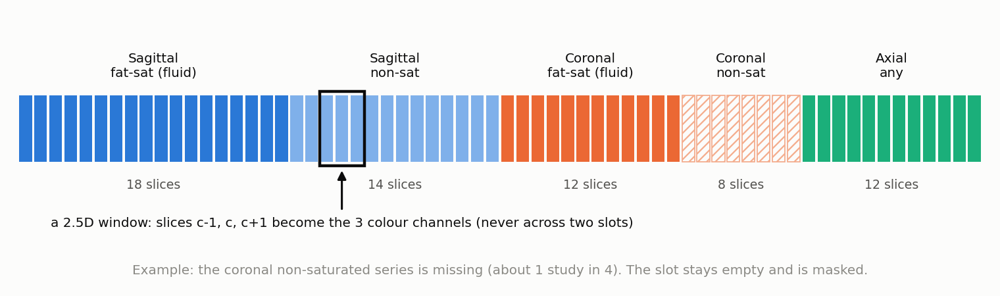
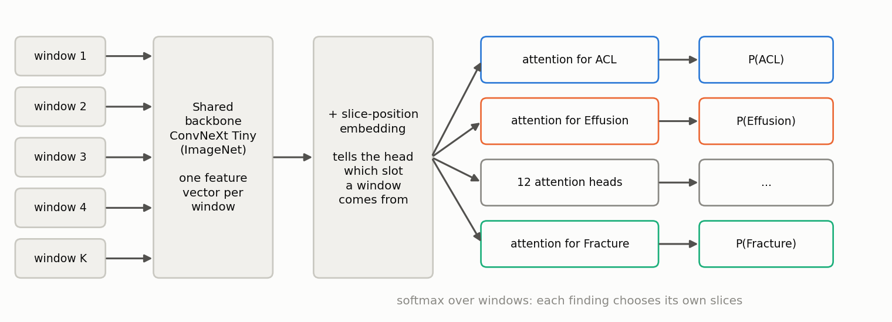

# Architecture

The work is split into Kaggle notebooks; each one writes its outputs, which the next ones
attach as inputs.

| Notebook | Hardware | Role | Output |
|---|---|---|---|
| 01 Series inventory | CPU | sort every series in space, check decoding | inventory, slice order |
| 02 LLM labels | 2 x T4 | turn reports into soft targets | `soft_labels.csv` |
| 03 Canonical volumes | CPU | build one 64-slice volume per study | `volumes_224.npy` (about 14 GB) |
| 04 Training | T4 | train the MIL model | `model_final.pt` |
| 05 Inference | CPU | predict the test set, average the models | `submission.csv` |

## 1. Series inventory

Each study holds several series (one acquisition each). The competition provides their plane
and sequence type, so nothing has to be guessed from DICOM text fields. The inventory only
reads headers to:

- **sort slices in space**, by their position along the normal of the image plane, never by
  file name (100 % of the 24,371 series could be sorted this way);
- read the **pixel spacing**, needed to crop in millimetres.

## 2. Canonical volume

A network needs inputs of fixed shape, while studies differ in series count, planes, slice
count and resolution. Each study is therefore turned into the same 64-slice layout.

| Slot | Plane | Preferred series | Slices | Typical use |
|---|---|---|---|---|
| 1 | sagittal | fluid sensitive, fat saturated | 18 | ACL, effusion, contusion, cyst |
| 2 | sagittal | not fat saturated | 14 | menisci, ligament anatomy, fracture |
| 3 | coronal | fluid sensitive, fat saturated | 12 | MCL, compartment oedema |
| 4 | coronal | second series | 8 | osteoarthritis, menisci |
| 5 | axial | any | 12 | patellofemoral joint, cyst, synovitis |

!!! info "A filing cabinet with five dividers"
    Each series is filed behind its divider, always in the same order. The network learns that
    slice 30 is always a coronal fat-saturated image, which is free and valuable information.
    A missing series leaves its divider empty, with a label saying so: the validity mask.

Three choices matter:

- **Crop in millimetres, not pixels.** A 140 mm square around the centre is taken whatever the
  scanner resolution, so the anatomy has the same scale in every image.
- **Sample from 6 % to 94 % of the stack.** Collateral ligaments and the lateral meniscus sit on
  peripheral slices; keeping only central slices would cripple two findings out of twelve.
- **Normalise per series** (percentiles 1 and 99): MRI intensities have no absolute unit.

A missing slot is **never filled with a series from another plane**: a declared absence is
better than false information. Coverage on the training set: axial 100 %, sagittal and coronal
fat-saturated about 95 %, coronal second series 77 %.

## 3. 2.5D windows

| Approach | Strength | Weakness |
|---|---|---|
| 2D slices | fast, ImageNet weights | no depth context |
| full 3D | full context | expensive, few pretrained models |
| **2.5D** | local depth, ImageNet weights | context limited to 3 slices |

!!! info "Three slices as three colours"
    A colour image has three channels: red, green, blue. A 2.5D window puts three neighbouring
    slices in place of the colours. The pretrained network sees a colour image but actually
    perceives a little depth.

Windows never cross a slot boundary, so a window never mixes two different series. A full
volume yields up to 54 windows; 24 random ones are used per study during training, all of them
at inference.

## 4. Multiple instance learning with per-finding attention

!!! info "Multiple instance learning"
    The label belongs to the whole bag (the study), not to each item (each window). The model
    has to discover which items justify the label. Digital pathology uses the same idea: one
    label for a whole slide, thousands of tiles.

How to turn many window vectors into 12 scores?

- **Averaging** dilutes the signal: an ACL tear visible on 2 windows out of 50 disappears.
- **Max pooling** is fragile: one odd window decides.
- **A single attention** imposes the same choice of windows on every finding, while an ACL tear
  lives on a few central sagittal slices and osteoarthritis spreads over many coronal ones.

KneeMIL uses **12 independent attention heads** over the same features: each finding computes its
own weighted average of the windows (softmax over windows), then its own classifier. A learned
**slice-position embedding** tells the head which slot each window comes from. Masked windows
receive a score of minus infinity, hence zero weight.

!!! info "Twelve specialists reading the same exam"
    Twelve radiologists leaf through the same slices, each stopping on the pages relevant to
    their speciality. The attention weights say where each one stopped, which makes every
    prediction inspectable.

## 5. Inference

The inference notebook rebuilds the canonical volume of each test study, runs every attached
model on all valid windows and averages the probabilities. It runs on CPU (no GPU queue, about
2 hours for 1,300 studies and one model), is fully offline (JPEG and JPEG 2000 decoders are
installed from wheels saved by notebook 01) and guards every study: a failure writes the mean
prevalence instead of crashing the submission.
