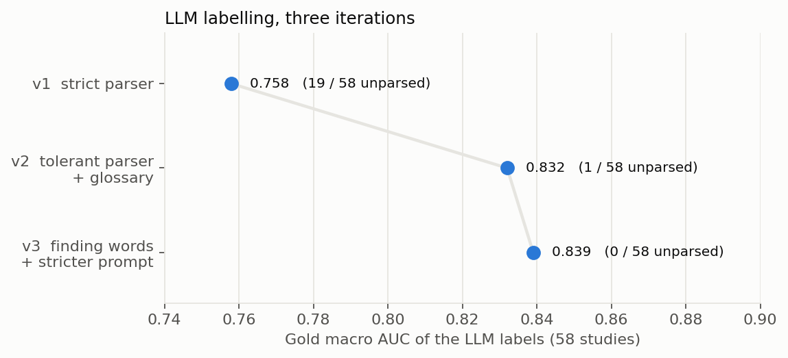

# LLM labelling

The 4,349 unlabelled studies only have a radiology report. Turning these reports into reliable
training targets is the step that decides everything else.

## Why an LLM, and why local

A first approach, keyword rules with a negation list, has clear limits on this data:

- it confuses structures (meniscal degeneration read as osteoarthritis);
- a negation word anywhere before a finding cancels it, even when it refers to something else;
- every language needs hand-written rules (Turkish, Spanish, Greek...).

An LLM reads context and handles languages natively. Since competition data may not be sent
to a third party, an open-weights model (**Qwen2.5 7B Instruct**, float16, on two T4 GPUs) runs
locally on Kaggle.

## Soft targets

The model grades each finding on five certainty levels, mapped to soft targets:

| Category | Meaning | Target |
|---|---|---|
| definite | clearly present | 0.95 |
| probable | likely, suspected, compatible with | 0.80 |
| possible | cannot be excluded, borderline | 0.40 |
| negative | explicitly absent or normal | 0.03 |
| not mentioned | the report says nothing | 0.07 |

!!! info "Grading a witness, not just yes or no"
    "I am sure I saw it" and "I think I saw it" are not worth the same. Binary labels would
    throw this information away and add noise. A finding the report does not mention is not a
    confirmed negative either, hence a small non-zero target.

## Three iterations, measured on the gold studies

The 58 gold reports were labelled first and compared with the expert labels before any
large run.

1. **Strict parser** (0.758): 19 answers out of 58 were rejected because a single value was not
   an expected category (for example `"tear"` or `"osteoarthritis"`), and rejected studies fell
   back to "not mentioned" everywhere. A Spanish report stating "Rotura ... del LCA" was labelled
   ACL negative: the model did not know that LCA is the Spanish ACL.
2. **Tolerant parser and multilingual glossary** (0.832): synonyms, truncated JSON and code
   fences are accepted; the prompt lists foreign abbreviations (LCA, LCM, menisco interno...).
   ACL jumped from 0.78 to 0.93.
3. **Finding words read as present and a stricter prompt** (0.839): a value such as `"tear"`
   now means present unless it contains a negation; no answer is lost.

The full run then labelled the 4,349 reports in 3 hours with **zero** unparsed answers.

## Memory-safe batching

Reports were first batched from shortest to longest with a fixed batch size of 16. The run
crashed with a CUDA out-of-memory error at 3,680 reports out of 4,349: the last batches only
held long reports. Batches are now sized by token count (batch size times longest prompt under
a budget), and a batch that still does not fit is split in two automatically. See
`kneemil.labels.make_batches` and `kneemil.labels.generate_safe`.

## The ceiling of text

Some disagreements with the gold labels are not LLM errors. A report stating "Rotura de menisco
interno" sits next to a gold label of 0; synovitis is often absent from reports while present in
the labels. The expert labels appear to come from the images, so a finding the report leaves out
cannot be recovered from text. This ceiling (effusion 0.77, synovitis 0.72) is exactly what the
image model is meant to overcome.
