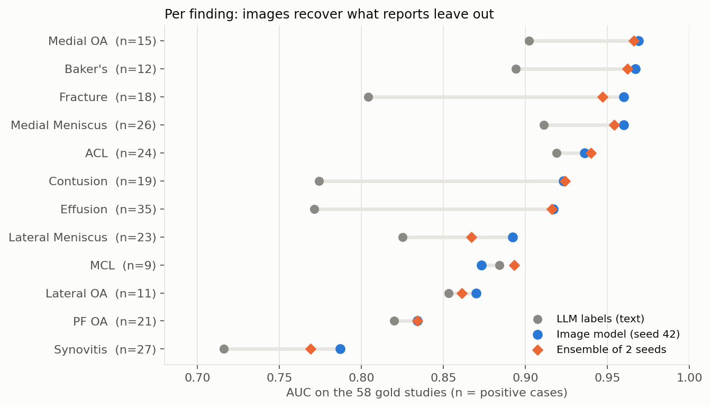

# Results

## Summary

| Model | Gold macro AUC (58 studies) | 95 % CI | Public leaderboard |
|---|---|---|---|
| LLM labels (text) | 0.839 | | |
| Image model, seed 42 | **0.907** | 0.879 to 0.932 | 0.899 |
| Image model, seed 7 | 0.890 | 0.859 to 0.917 | |
| Ensemble of the two seeds | 0.903 | 0.873 to 0.928 | **0.906** |

At the time of submission, the best public scores were around 0.95 to 0.96.

## The student overtakes its teacher

The image model never saw an expert label: it learned only from the LLM targets. It still scores
higher than those targets (0.907 against 0.839). Errors in the text labels are scattered and
inconsistent, while the visual signs of each finding are regular; seen over thousands of
examples, the consistent signal wins.

The largest gains are where text was weakest:

| Finding | LLM labels | Image model |
|---|---|---|
| Fracture | 0.80 | 0.96 |
| Effusion | 0.77 | 0.92 |
| Contusion | 0.77 | 0.92 |
| Medial OA | 0.90 | 0.97 |

Synovitis (0.79) and patellofemoral osteoarthritis (0.83) remain the hardest findings. MCL and
lateral osteoarthritis have only 9 and 11 positive gold cases, so their AUC is very uncertain.

## A small validation set can mislead

On the gold studies, the ensemble (0.903) looked slightly **worse** than the best single model
(0.907). On the public leaderboard (a larger test subset) it was **better**: 0.906 against 0.899.
The gap between the two seeds on the gold set (0.017) was larger than the difference being
judged, so the gold set could not decide; the general principle (averaging models reduces
variance) held. Both submissions were kept as final selections.
