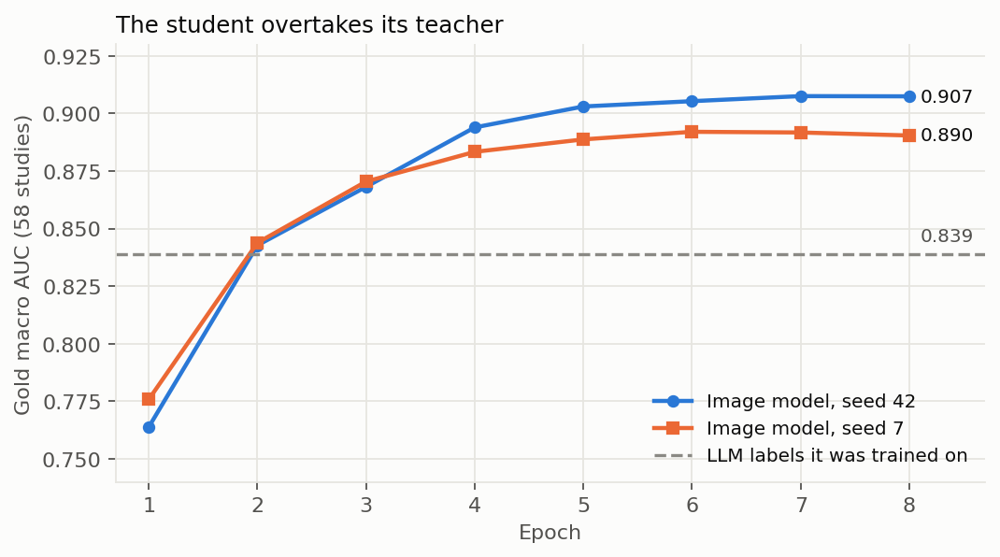

# Training and evaluation

## Setup

| Element | Value | Reason |
|---|---|---|
| Training set | 4,132 studies with LLM soft targets | gold studies excluded |
| Internal validation | 217 studies (5 %) | learning signal, contaminated by label noise |
| Gold evaluation | 58 studies | the only honest measure |
| Loss | binary cross-entropy on soft targets | accepts continuous targets |
| Optimiser | AdamW, weight decay 0.02 | |
| Learning rates | backbone 3e-5, head 1e-4 | keep pretrained features |
| Schedule | cosine with 5 % warm-up | |
| Precision | mixed (float16) | halves memory on a T4 |
| Windows per study | 24 random at training, all at inference | memory |
| Batch | 4 studies, gradient accumulation 2 | |
| Epochs | 8 | beyond, the model starts memorising label noise |
| Weights | exponential moving average over the last two thirds | smooths the end of training |

!!! info "Gradient accumulation"
    If the bag only holds four studies at a time, make two trips before updating the model.
    The result behaves like a bigger batch without the memory it would need.

## Augmentations

Mild and anatomically plausible, identical for every window of a study: small rotations (up to
8 degrees), zoom and translation, contrast and brightness changes.
**No horizontal flip**: it would turn a right knee into a left one and swap medial and lateral,
which four findings depend on.

## Choosing the final model honestly

The final model is the **last epoch**, not the epoch with the best gold score. Selecting on 58
studies would overfit the only honest evaluation set.

## Bootstrap

!!! info "How much of a difference is noise?"
    Resample the 58 studies with replacement a thousand times and recompute the score each
    time. The spread of these scores (the 95 % interval) shows how much a difference between
    two models can be explained by chance alone.

## Learning curves

Both seeds pass the LLM labels after two epochs and plateau from epoch 6, without signs of
overfitting. Training takes about 70 minutes on one T4 GPU.

The two curves are the **same model on the same data**: only the random seed differs. Their
final gap (0.017) is a direct measure of how noisy a 58-study evaluation is.
